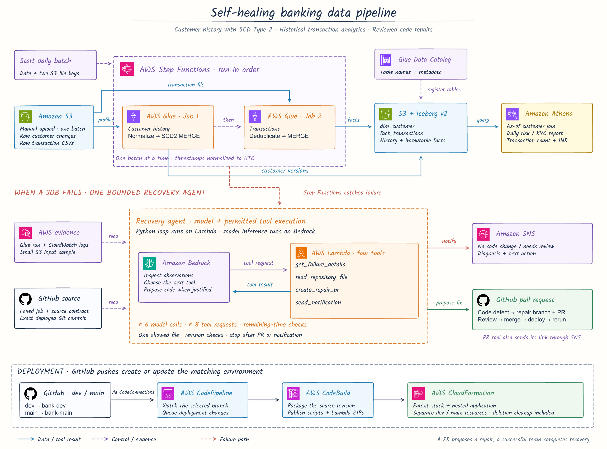
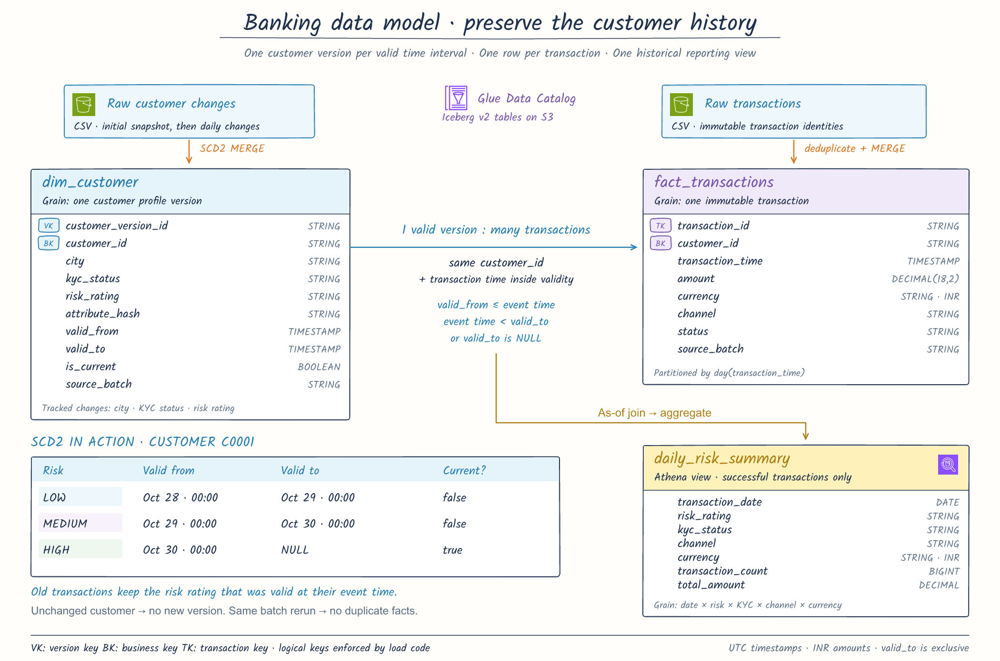

# Self-Healing Banking Pipeline

An AWS data pipeline that preserves customer profile history, loads transaction
facts, and explains processing failures. When the evidence establishes a code
defect, a repair agent proposes a focused GitHub pull request. A developer reviews
and merges the change, the branch deployment runs, and the failed batch is rerun.

**Start with [EXECUTION.md](EXECUTION.md) for the complete console-first setup and
execution sequence. No local deployment environment is required.**

**Sample inputs are included in [data/generated/](data/generated/).** Open the
customer and transaction CSVs before deployment to inspect the data. Upload each
batch manually to the environment's S3 bucket under `raw/`, then start its Step
Functions execution. CodeBuild deploys code and infrastructure only; it does not
generate data or upload CSVs.

## Business problem

Customer risk ratings, KYC status, and location can change over time. Joining old
transactions to only the latest customer profile rewrites their historical
classification. A report should answer: **what was the customer's profile when
this transaction occurred?**

This project maintains an SCD Type 2 customer dimension and an immutable transaction
fact table. An Athena view reports successful transaction count and amount in INR
by date, historical risk rating, historical KYC status, and payment channel. Risk
and KYC values are supplied by the source system; this project does not calculate
credit scores or make account decisions.

Operational failures need different responses. A missing source file needs a new
delivery; a parser that rejects a documented timestamp format needs a code change.
The recovery agent uses failed-run evidence and the source contract to distinguish
these situations and either publish an SNS alert or propose a code correction.

## Architecture



The [editable SVG](docs/images/architecture.svg) includes the handwriting font and
official AWS service icons. [Asset sources and notices](docs/images/ASSET-NOTICES.md)
are included with the diagrams.

- **GitHub → CodeConnections → CodePipeline → CodeBuild:** pushes to `dev` deploy
  the development environment; changes merged into `main` deploy a separate main
  environment. Each environment has its own parent CloudFormation stack.
- **CloudFormation:** the parent owns deployment resources and a nested application
  stack. CodeBuild publishes artifacts under the source commit and updates the
  parent, which creates or updates the application.
- **S3 + Glue:** upload each dated CSV batch manually before starting the workflow.
  The customer job applies SCD2 changes; the transaction job cleans,
  deduplicates, and merges transaction identities. Iceberg v2 tables are registered
  in the Glue Data Catalog.
- **Step Functions:** runs the two jobs in order, waits for each to finish, and
  catches task failures. Start one batch at a time in date order.
- **Athena:** queries the two Iceberg tables and the `daily_risk_summary` view.
- **Lambda + Bedrock:** Lambda hosts a bounded agent loop. The model chooses tools
  to inspect failure evidence, read the deployed source and contract, and either
  propose a repair PR or send a notification. Each tool result informs its next choice.
- **GitHub + SNS:** the agent modifies only the failed job's file on a new branch.
  Its PR targets the branch that deployed the failure. Notifications describe the
  diagnosis and, when available, link to the PR.

Each job has two G.1X workers and a ten-minute timeout. The implementation uses one
repair handler and ordinary SDK calls; it does not introduce an agent framework,
evaluation system, or unit-test suite. Runtime input checks protect business data.

## How the recovery agent works

The recovery agent runs on AWS Lambda, uses a Bedrock model to choose investigation
steps, and interacts with AWS and GitHub through four tools. It proposes a repair
through a pull request, which a developer reviews and merges. Lambda is the runtime;
Bedrock supplies the model; the Python handler executes permitted tool requests.

Step Functions supplies the failed job and execution ID. The model initially sees
the investigation goal and available tools. It requests an action through Bedrock
Converse, Lambda validates and executes that request, and the tool result is sent
back to the model. The model then chooses its next action using that observation.
The model's next choice depends on the failure and the observations it has received.

| Tool | What it does |
| --- | --- |
| `get_failure_details` | Finds the Glue run for this execution and reads its metadata, driver logs, and up to 4 KiB of synthetic input. |
| `read_repository_file` | Reads the failed job's Python file or `docs/source-contract.md` at the exact deployed Git commit. |
| `create_repair_pr` | Accepts a proposed correction, checks the allowed file and revision, parses Python syntax, creates or reuses a repair PR, and sends its link through SNS. Ends the agent run. |
| `send_notification` | Sends a diagnosis and next action to the configured SNS topic with `NO_CODE_CHANGE` or `NEEDS_REVIEW`. Ends the agent run. |

For a missing file, the model can inspect the failure and choose notification
without reading GitHub. For a parser defect, it can inspect the failure, request
the job source and contract, and submit the corrected file through the PR tool.
Rejected tool requests return an error to the model, which can correct its request
or request manual review. Requests in the same model response execute sequentially;
the first successful terminal action ends processing.

The handler enforces **at most six model calls and eight tool requests per
invocation**. Each model response has an 8,000-token output limit. Lambda has a
15-minute timeout, and remaining-time checks reserve time for notifications rather
than starting another operation near that limit. Missing evidence, exhausted
budgets, truncated output, or a response without a tool request leads to manual
review. A failed fallback notification is handled by Step Functions' SNS path.

The model cannot select another repository, branch, recipient, or writable file.
Creating a repair requires a matching failed run plus prior reads of the source
and contract. Known source-data and permission error markers block code changes
in Python. The failed revision must match the deployed revision, and the target
branch is checked before writing and again before opening a new PR. The branch
name is derived from the execution ID so retries reuse the same incident's PR.

CloudWatch records model-turn counts and tool names with success/error status.
The Lambda result also includes `tool_trace`, `model_calls`, and `tool_calls`.
Application logs do not print prompts, source files, input samples, or secrets.
Conversation state lives only in that invocation; no separate memory service or
agent hosting service is required.

## Data model



The [editable SVG](docs/images/data-model.svg) is also available.

`dim_customer` stores `customer_version_id`, `customer_id`, `city`, `kyc_status`,
`risk_rating`, `attribute_hash`, `valid_from`, `valid_to`, `is_current`, and
`source_batch`. A hash of the three tracked attributes identifies actual changes.
An update closes the prior version and inserts the replacement in one Iceberg
MERGE. Unchanged profiles do not create a version.

`fact_transactions` stores immutable transaction identities, customer business
keys, event times, decimal amounts, currency, channel, status, and source batch.
It is partitioned by transaction day. Identical retransmissions are ignored;
conflicting records stop the job. A transaction must have a valid customer profile
at its event time.

The reporting join uses `customer_id` and a half-open validity interval:

```sql
f.customer_id = d.customer_id
AND f.transaction_time >= d.valid_from
AND (f.transaction_time < d.valid_to OR d.valid_to IS NULL)
```

All internal timestamps are UTC. Money uses `DECIMAL(18,2)`. Logical uniqueness is
maintained by the load rules; Iceberg does not enforce primary or foreign keys.
The complete accepted formats are in [the source contract](docs/source-contract.md).

## Recovery behavior

| Situation | Response |
| --- | --- |
| Source file missing | SNS diagnosis and delivery action; no code change. |
| Conflicting rows or out-of-order customer changes | SNS diagnosis; correct the source. |
| Documented timestamp format rejected by the parser | Propose a focused parser correction in a GitHub PR. |
| Evidence insufficient, model unavailable, branch revision changed, or agent budget exhausted | SNS request for manual review. |

The failed workflow stays **FAILED** after an alert or PR. Recovery is complete only
after the corrected input or approved deployment successfully processes the batch.
The agent does not merge PRs, deploy code, execute generated code, or alter risk/KYC
values. It parses proposed Python syntax before publishing a PR and states that the
code has not been run. Model output still requires developer review.

The checked-in parser already handles both supported timestamp formats. The
execution guide includes a deliberate development-branch regression to exercise
the repair path; a fresh deployment processes all three batches successfully.

## Repository map

| File | Purpose |
| --- | --- |
| `README.md` | Business problem, architecture, data model, and code map. |
| `EXECUTION.md` | Sequential console setup, deployments, executions, troubleshooting, and deletion. |
| `buildspec.yml` | CodeBuild dependency installation, syntax validation, and deployment command. |
| `requirements.txt` | AWS SDK dependency installed inside CodeBuild. |
| `.gitignore` | Excludes local environments, caches, and temporary files; keeps the supplied synthetic dataset visible. |
| `infra/platform.yaml` | Directly uploadable parent template: branch connection, CodePipeline, CodeBuild, artifact bucket, secret, roles, cleanup, and nested application. |
| `infra/application.yaml` | Data bucket, catalog database, workgroup, two jobs, workflow, agent, SNS, logs, runtime roles, and application cleanup. |
| `infra/cleanup.py` | CloudFormation deletion hook: stops active writers, removes catalog tables/views, and empties owned buckets including versions. |
| `jobs/customer_history.py` | Customer input normalization, source checks, change comparison, and atomic SCD2 MERGE. |
| `jobs/transactions.py` | Transaction normalization, decimal handling, deduplication, history matching, and insert-only MERGE. |
| `agent/handler.py` | Four tool definitions, bounded Converse loop, input validation, failure evidence, revision checks, one-file repair PR, notification, and compact tool trace. |
| `scripts/deploy.py` | Runs inside CodeBuild; uploads code artifacts, updates the parent stack, and prints the destination for manual batch uploads. |
| `scripts/generate_data.py` | Optional local utility to recreate the supplied synthetic files and expected-results manifest; never called by deployment. |
| `data/generated/2026-10-28/` | Initial customer snapshot and first transaction batch. |
| `data/generated/2026-10-29/` | Customer updates, second transaction batch, and a separate conflicting-customer delivery. |
| `data/generated/2026-10-30/` | Further customer updates using ISO timestamps with offsets and the third transaction batch. |
| `data/generated/expected-results.json` | Exact batch counts, successful transaction amounts, and cumulative table counts. |
| `sql/analytics.sql` | Creates the historical reporting view and selects the daily summary. |
| `docs/source-contract.md` | Required input formats and business rules, also used as evidence by the agent. |
| `docs/images/architecture.svg` / `.png` | Editable architecture diagram and rendered README image. |
| `docs/images/data-model.svg` / `.png` | Editable data model and rendered README image. |
| `docs/images/ASSET-NOTICES.md` | Icon attribution and the embedded handwriting font's license. |

The parent template includes an inline copy of `infra/cleanup.py` because its first
console deployment has no artifact bucket yet. CodeBuild refreshes that inline copy
from the Python file on later deployments. The nested application uses a ZIP of the
same file.

## Sample data and operating boundaries

The supplied CSVs contain invented banking records and are ready to inspect in
[data/generated/](data/generated/). The batch dates are fixed example dates;
use them unchanged even when running the project on a later day.

| Batch | Customer CSV rows | Transaction CSV rows | Unique transactions | Purpose |
| --- | --- | --- | --- | --- |
| [2026-10-28](data/generated/2026-10-28/) | 1,000 | 3,010 | 3,000 | Initial customer snapshot and transaction load. |
| [2026-10-29](data/generated/2026-10-29/) | 100 | 3,510 | 3,500 | Change 100 customer profiles and retain their earlier versions. |
| [2026-10-30](data/generated/2026-10-30/) | 100 | 3,510 | 3,500 | Change those profiles again using supported timezone-offset timestamps. |

Counts exclude CSV headers. The separate October 29 `customers-conflict.csv` has
101 rows and is used only for the source-error scenario. The expected successful
amounts and cumulative counts are in [expected-results.json](data/generated/expected-results.json).

After manually uploading and processing the three batches, there are 1,000
customers, 10,000 unique transactions, and 1,200 customer versions.
Each transaction file includes ten identical repeated records to demonstrate safe
reprocessing. An additional customer file contains a deliberate source conflict.

For each iteration, upload only that day's `customers.csv` and `transactions.csv`
into `s3://<DataBucketName>/raw/<batch-date>/`. For example, the local file
`data/generated/2026-10-28/customers.csv` belongs at
`s3://<DataBucketName>/raw/2026-10-28/customers.csv`. The
[manual upload plan](EXECUTION.md#manual-upload-plan) lists every iteration,
including the conflict and missing-delivery scenarios. The manifest is a local
reference and does not need to be uploaded.

Wait for each upload to finish, start its Step Functions execution, and wait for
the result before proceeding. Uploading files does not start processing. Later
code deployments preserve manually uploaded source files.

The supplied files are ready to use. To deliberately recreate them locally,
`python3 scripts/generate_data.py` refreshes `data/generated/` without AWS access.
This optional utility is separate from CodeBuild and deployment; it is not a
required setup step.

Run a single workflow at a time. Customer batches must arrive in order, with at
most one distinct change per customer per batch. Rerun a failed/current batch before
advancing to the next. Backdated customer corrections, parallel processing, live
CDC, and multi-currency conversion are outside this implementation.

The two table commits are independent: if the customer job commits and the
transaction job fails, customer history remains committed. Rerunning that same
batch leaves the customer versions unchanged and retries the transaction load.
CloudFormation rollback restores infrastructure definitions; it does not undo
business-data commits.

## Deletion

Every declared resource has `DeletionPolicy: Delete` and `UpdateReplacePolicy:
Delete`. The parent and application have cleanup hooks because those attributes
alone cannot delete a nonempty S3 bucket. Delete the **parent** stack to remove its
application, artifacts, all S3 object versions, job-created catalog tables/views,
logs, secret, jobs, agent, workflow, topic, connection, and deployment resources.

Deletion permanently removes that environment's data. GitHub repositories, PRs,
tokens issued by GitHub, and the GitHub App installation are external to these
stacks. Service-managed operational history may remain for AWS's normal retention
periods. See [the deletion instructions](EXECUTION.md#12-delete-an-environment).

## AWS reference

- [Glue Iceberg configuration](https://docs.aws.amazon.com/glue/latest/dg/aws-glue-programming-etl-format-iceberg.html)
- [Step Functions Glue integration](https://docs.aws.amazon.com/step-functions/latest/dg/connect-glue.html)
- [GitHub source connections and branch triggers](https://docs.aws.amazon.com/codepipeline/latest/userguide/action-reference-CodestarConnectionSource.html)
- [Athena Iceberg support](https://docs.aws.amazon.com/athena/latest/ug/querying-iceberg.html)
- [CloudFormation deletion policies](https://docs.aws.amazon.com/AWSCloudFormation/latest/TemplateReference/aws-attribute-deletionpolicy.html)
- [Bedrock Converse tool use](https://docs.aws.amazon.com/bedrock/latest/userguide/tool-use.html)
- [Amazon Nova tool calls and results](https://docs.aws.amazon.com/nova/latest/userguide/tool-use.html)
